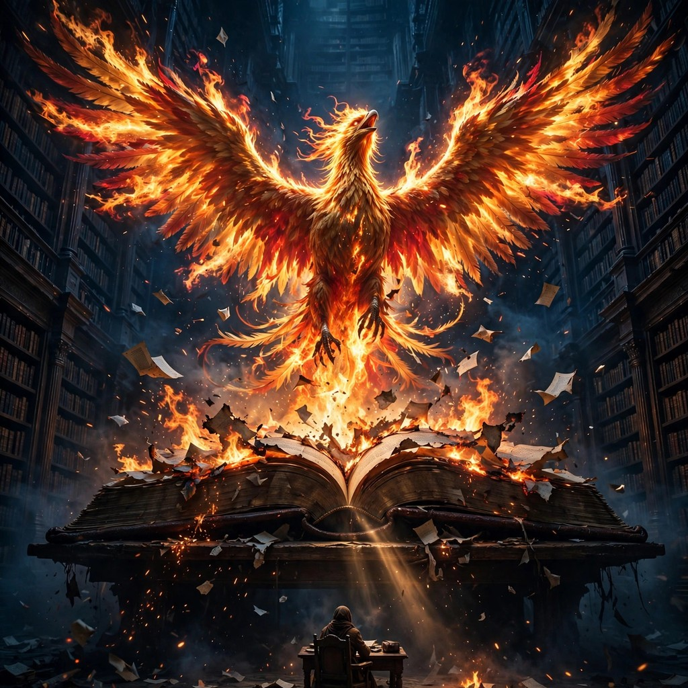

# Phoenix Rising from the Burning Book

In a grand dark library at night, a colossal blazing phoenix bursts out of a giant glowing ancient book open on a lectern, burning pages and embers exploding outward as a tiny lone reader far below looks up in awe — bright warm firelight against cool blue darkness.

- Bounty: [ai-excited-01 — Make the AI judge excited](https://make.fun/bounty/ai-excited-01)
- Leaderboard: [ai-excited-01 leaderboard](https://make.fun/bounty/ai-excited-01/leaderboard)

